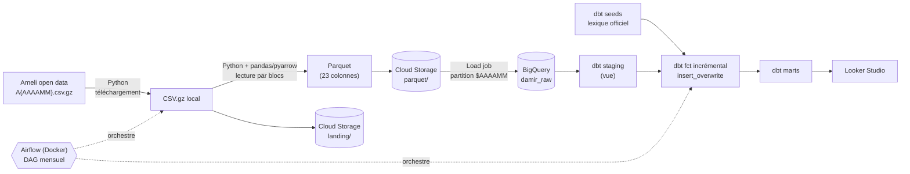

# Pipeline de données santé sur Google Cloud — Open DAMIR


Pipeline de bout en bout qui ingère chaque mois les remboursements de l'Assurance Maladie
(**Open DAMIR**, tous régimes, plusieurs millions de lignes par mois), les modélise
dans **BigQuery** avec **dbt**, l'ensemble étant orchestré par **Airflow**, et les restitue dans un tableau de bord
**Looker Studio**.

**Question métier** : où va la dépense de santé remboursée ? Par poste de soins, région, âge et
sexe, avec le taux de prise en charge par l'Assurance Maladie et son évolution mois par mois.

---

## Architecture



| Étape | Outil | Détail |
|---|---|---|
| Ingestion | Python (`ingestion/`) | Téléchargement idempotent, contrôle de l'en-tête par rapport au lexique, conversion CSV.gz → Parquet par blocs de 500 000 lignes |
| Zone de dépôt | Cloud Storage | `landing/` (CSV bruts, purgés après 30 jours) et `parquet/flx_month=AAAA-MM/` |
| Entrepôt | BigQuery | Table brute partitionnée par mois et clusterisée ; chargement par partition en `WRITE_TRUNCATE` |
| Transformation | dbt (`dbt/`) | seeds → staging → fait incrémental → marts, 54 tests, documentation et lignage |
| Orchestration | Airflow 3 (`airflow/`) | DAG mensuel, *dynamic task mapping* par mois, puis `dbt seed/run/test/docs` |
| Restitution | Looker Studio | Branché sur les marts uniquement |
| CI | GitHub Actions | ruff, pytest, import du DAG, `dbt parse` ; `dbt test` mensuel sur BigQuery |

## Choix techniques

- **Rejouable sans doublon.** Chaque mois est chargé dans sa propre partition BigQuery
  (`prestations$202401`) en `WRITE_TRUNCATE`, et le fait dbt utilise `insert_overwrite` :
  relancer un mois remplace ses données au lieu de les dupliquer.
- **Incrémental piloté par la date d'ingestion.** `fct_depenses_mensuelles` ne recalcule que les
  mois dont des lignes ont été (re)chargées depuis la dernière exécution.
- **Dimensionné pour l'offre gratuite.** Seules 23 des 55 variables sont conservées, le Parquet
  est compressé en zstd, le staging est une vue (pas de copie du volume brut) et les marts ne font
  que quelques dizaines de milliers de lignes par mois. Les profils dbt plafonnent chaque requête
  (`maximum_bytes_billed`).
- **Typage dans l'entrepôt, pas à l'ingestion.** La zone brute garde les valeurs telles que
  publiées (STRING) ; les conversions (virgule décimale, codes « 11.0 », dates de soins invalides)
  sont centralisées dans des macros dbt et testées.
- **Nomenclatures versionnées.** Les libellés viennent du lexique officiel (`ingestion/build_seeds.py`) ;
  les 600 natures de prestation sont regroupées en 43 postes de soins à partir de la structure du
  code PRS_NAT (seed `ref_poste_soins`).
- **dbt isolé d'Airflow.** dbt tourne dans son propre environnement virtuel dans l'image, pour
  éviter les conflits de dépendances.

## Modèle de données

| Couche | Modèle | Grain |
|---|---|---|
| Source | `damir_raw.prestations` | Ligne Open DAMIR (partition = mois de traitement) |
| Staging | `stg_damir__prestations` | Idem, renommée et typée |
| Fait | `fct_depenses_mensuelles` | Mois × prestation × enveloppe × nature d'assurance × secteur × région × âge × sexe × catégorie d'exécutant |
| Marts | `mart_depenses_postes` | Mois × poste de soins × région × âge × sexe (table du tableau de bord) |
|  | `mart_kpi_mensuels` | Mois × grand poste, avec évolution mensuelle |
|  | `mart_top_prestations` | Mois × prestation, avec rang |

**Qualité des données** : unicité du grain de chaque table, clés étrangères vers les nomenclatures,
valeurs autorisées (âge, sexe, grands postes), et trois tests métier :
réconciliation des montants entre staging et fait au centime près, taux de prise en charge
plausible, part de dépense non classée inférieure à 1 %.

Documentation dbt : `make dbt-docs` (lignage complet jusqu'au tableau de bord, déclaré en *exposure*).

## Tableau de bord

Lien : *[à ajouter]*


## Enseignements

> Période analysée : *[à compléter, ex. janvier à mars 2024]*. Requêtes : `dbt/analyses/enseignements.sql`.

1. *[Poids des postes : ex. « Les médicaments et les auxiliaires médicaux représentent X % de la dépense de soins de ville »]*
2. *[Effet de l'âge : ex. « Les 60 ans et plus concentrent X % de la dépense de soins de ville »]*
3. *[Reste à charge : ex. « Le dentaire et l'optique ont le taux de prise en charge le plus faible (X %) »]*
4. *[Région ou évolution mensuelle : ex. « La dépense de transports varie de X % d'un mois à l'autre »]*

## Lancer le projet

Guide détaillé : [`docs/GUIDE.md`](docs/GUIDE.md).

```bash
cp .env.example .env            # renseigner GCP_PROJECT_ID et GCS_BUCKET
bash infra/setup_gcp.sh         # bucket, datasets, compte de service
make install
make ingest-sample MONTH=2024-01   # essai sur 200 000 lignes
make dbt-build
make airflow-up                 # http://localhost:8080
```

## Limites et pistes

- Les montants ne sont pas rapportés à la population : une jointure avec les estimations INSEE
  par région et tranche d'âge permettrait des dépenses par habitant.
- L'infrastructure est créée par script `gcloud` ; une version Terraform rendrait l'environnement
  reproductible et versionné.
- Airflow tourne en local ; en production, Cloud Composer ou un job Cloud Run planifié.
- La série couvre surtout les soins de ville et l'hospitalisation privée : l'essentiel de
  l'hôpital public n'est pas dans Open DAMIR.

## Source et licence

Données : Assurance Maladie, *Open Damir : base complète sur les dépenses d'assurance maladie
interrégimes*, Licence Ouverte / Open Licence (Etalab). Code : MIT.
